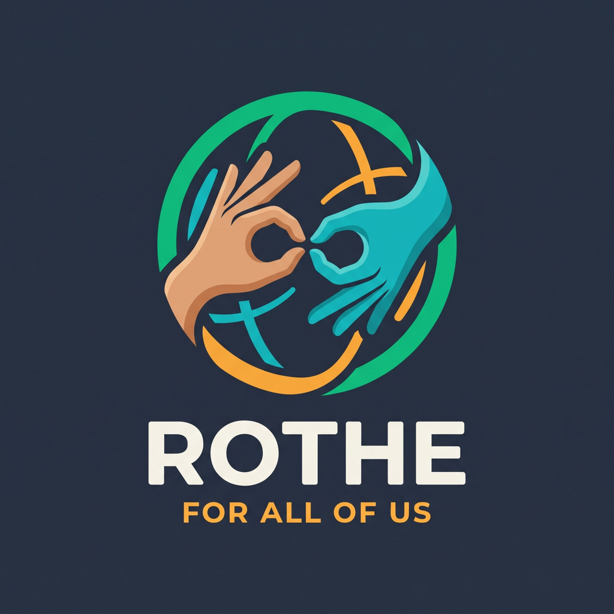

<p align="center"></p>

## Rothe

Rothe ("all of us" in Tshivenda) turns a teacher's live speech into **local sign language** for Deaf learners: South African (SASL), Nigerian (NSL), Kenyan (KSL) and American (ASL) Sign Language.

```
Teacher speaks ──► Web Speech API ──► /api/gloss (Claude) ──► sign gloss ──► sign player
 (en / es / fr /     (in browser)      grammar, not           TODAY WE LEARN   clips, gloss cards,
  zu / af / sw)                        word-for-word          ELECTRICITY      fingerspelling
```

- **Grammar-aware translation.** Claude reorders speech into sign grammar (time → topic → comment, wh-word last), drops filler words, and marks facial grammar (e.g. eyebrows raised for yes/no questions).
- **Pick the sign language per learner.** The AI layer and the sign media are separate, so switching SASL → NSL re-signs the same sentence.
- **Never stalls.** If the AI call fails or times out, an offline rule-based engine takes over (badge shows *Offline*).
- **Real-time queue.** Translation runs in parallel while playback stays in spoken order; *Live* button skips the backlog.
- **Classroom mode (Azure Web PubSub).** The teacher's phone broadcasts each sentence to a room; every learner's phone signs it in **their own** sign language. The classroom code is the room, so there is no database.

### Run it

```bash
pnpm install
cp .env.example .env.local   # add Azure OpenAI, Anthropic and/or Gemini keys (tried in that order)
pnpm dev
```

Open http://localhost:3000 in **Chrome or Edge** (Web Speech API). Single-device mode works with no other setup; without an API key it uses the offline engine.

Classroom mode needs an Azure Web PubSub resource (Free tier is enough for a class):

```bash
az webpubsub create -n <name> -g <resource-group> -l southafricanorth --sku Free_F1
az webpubsub key show -n <name> -g <resource-group> --query primaryConnectionString -o tsv   # -> AZURE_WEBPUBSUB_CONNECTION_STRING
```

Then open the **Classroom** tab: *Start a classroom* on the teacher's phone, and learners join with the code (or open `/class/<CODE>`).

> Phones need **HTTPS** for the microphone: deploy to Vercel and add the variables below in the project settings.

### Adding real sign clips

Without clips every sign shows as a gloss card, and fingerspelled words show letter by letter. To add video:

1. Record short clips (1–2 s, plain background), e.g. `public/signs/sasl/hello.mp4`.
2. List them in `public/signs/manifest.json`:

```json
{ "SASL": { "signs": { "HELLO": "sasl/hello.mp4", "LEARN": "sasl/learn.mp4" },
            "alphabet": { "A": "sasl/alphabet/a.png" } } }
```

Gloss keys are uppercase, hyphenated for multi-word signs (`THANK-YOU`). No code change needed.

Sign clips should be recorded or reviewed by native Deaf signers of each language.

### Environment

| Variable | Where | Purpose |
|---|---|---|
| `AZURE_OPENAI_ENDPOINT`, `AZURE_OPENAI_API_KEY`, `AZURE_OPENAI_DEPLOYMENT` | server | Azure OpenAI translation, tried first (`AZURE_OPENAI_API_VERSION` optional) |
| `ANTHROPIC_API_KEY` | server | Claude translation, tried second |
| `GEMINI_API_KEY` | server | Gemini translation (free tier), tried last |
| `GEMINI_MODEL` | server, optional | Override model (default `gemini-flash-lite-latest`) |
| `ANTHROPIC_MODEL` | server, optional | Override model (default `claude-opus-5-5`) |
| `AZURE_WEBPUBSUB_CONNECTION_STRING` | server | Classroom broadcast (Azure Web PubSub) |

### Layout

| Path | What |
|---|---|
| `app/api/gloss/route.ts` | Speech → sign gloss (Azure OpenAI, then Claude, then Gemini) |
| `app/api/classroom/route.ts` | Classroom codes and Web PubSub room tokens |
| `app/page.tsx`, `app/classroom` | Live tab (single phone) and Classroom tab |
| `app/class/[code]/teach`, `app/class/[code]` | Teacher console / learner screen |
| `components/signbridge/` | Teacher console, learner screen, sign player |
| `hooks/` | Continuous speech recognition, ordered sign queue, screen wake lock |
| `lib/signbridge/` | Languages, offline gloss engine, sign media manifest |
